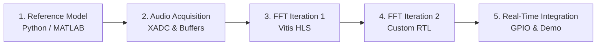

# FPGA Guitar Tuner (FPGAtors)

A real-time guitar tuner and frequency detector built on the Digilent Zybo Z7-10 / Avnet Zedboard.

An analog audio signal is sampled using the Zynq-7000's built-in Hard IP Analog-to-Digital Converter (XADC). The time-domain audio is converted to the frequency domain via a hardware-accelerated Fast Fourier Transform (FFT) to detect note frequencies and display tuning feedback on onboard LEDs/GPIO in real time.

---

## Learning Path & Implementation Strategy

To build an intuitive, step-by-step understanding of the FFT, hardware acceleration, and DSP, the project uses three separate iterations of increasing design complexity:

1. **Iteration 1: Golden Reference (Software)**
   - Implement the FFT and pitch detection in Python (NumPy/SciPy) or MATLAB.
   - Establish baselines for sampling rate, windowing, resolution, and test vectors.
2. **Iteration 2: High-Level Synthesis (HLS)**
   - Implement the FFT in C/C++ with fixed-point arithmetic (`ap_fixed`) using Vitis HLS.
   - Focus on algorithmic structure, loop pipelining, and dataflow optimization without writing raw register logic.
3. **Iteration 3: Register-Transfer Level (RTL)**
   - Begin with the baseline pipelined FFT architecture detailed in [Tan F. Wong's RFSoC Notes (Chapter 8: FFT Implementation)](https://tanfwong.github.io/rfsoc_notes/ch8/impl.html) to understand the foundational hardware structure.
   - Branch off into our own custom RTL core built from the ground up in Verilog / SystemVerilog, optimizing the butterfly pipeline stages, twiddle-factor storage/addressing, throughput, and resource footprint.
   - Gain a cycle-accurate understanding of hardware DSP architectures.

Finally, we compare the implementations across execution speed, hardware resource utilization (LUTs, DSP slices, BRAM), and design effort.

---

## Project Goals

- **Real-Time Use:** Continuous sample capture, low-latency FFT computation, and live pitch indication.
- **Progressive Understanding:** Move gradually from high-level math to C++ HLS, then down to custom RTL hardware.
- **SoC Interfacing:** Gain hands-on experience with hard IP ADCs (XADC), AXI streaming, BRAM, and physical board GPIO.
- **Low Barrier to Entry:** Have fun and build something functional—all club members are welcome regardless of experience.

---

## Hardware & Software

### Hardware
- **FPGA Board:** Digilent Zybo Z7-10 or Avnet Zedboard (Xilinx Zynq-7000 SoC)
- **Audio Input:** 3.5mm jack or 1/4" guitar cable to auxiliary connection
- **Analog Conditioning:** Simple bias/filter circuit to fit the 0–1V XADC input range
- **Feedback:** Onboard LEDs, switches, buttons, or optional Pmod display

### Software
- **Vivado:** Synthesis, implementation, block design, and bitstream generation
- **Vitis & Vitis HLS:** Embedded drivers, bare-metal application, and C++ to RTL synthesis
- **Python (SciPy / NumPy) or MATLAB:** DSP exploration, simulations, and test vector generation

---

## Target Notes (Standard Tuning)

| String | Note | Target Frequency |
|:------:|:----:|:----------------:|
| 6 | E2 | 82.41 Hz |
| 5 | A2 | 110.00 Hz |
| 4 | D3 | 146.83 Hz |
| 3 | G3 | 196.00 Hz |
| 2 | B3 | 246.94 Hz |
| 1 | E4 | 329.63 Hz |

---

## Semester Milestones

### Milestone 1: Audio Spectrum & Golden Model (Weeks 1–3)
- Analyze guitar waveforms, harmonics, and windowing functions.
- Write a Python / MATLAB script to read audio, compute the FFT, and identify fundamental pitch.
- Choose FFT size ($N$) and sampling frequency ($f_s$) to balance latency and frequency resolution.
- Export reference test vectors for hardware verification.

### Milestone 2: XADC Hardware Setup (Weeks 4–6)
- Connect and bias analog input signal within the XADC's 0–1V range.
- Configure XADC Hard IP in Vivado.
- Buffer continuous audio samples into BRAM / FIFO.
- Verify captured samples via ILA or UART printout.

### Milestone 3: FFT Iteration 1 — HLS (Weeks 7–9)
- Write Cooley-Tukey FFT in C/C++ using fixed-point types.
- Apply HLS optimization directives (pipelining, unrolling, partitioning).
- Verify outputs against Python test vectors using C/RTL co-simulation.
- Package core as an AXI IP block for integration into Vivado.

### Milestone 4: FFT Iteration 2 — Custom RTL (Weeks 10–12)
- Study and bring up the baseline pipelined FFT structure based on [Tan Wong's RFSoC Chapter 8](https://tanfwong.github.io/rfsoc_notes/ch8/impl.html).
- Design and build our custom FFT module from the ground up in Verilog / SystemVerilog with optimized butterfly pipeline stages, twiddle lookup tables, and addressing logic.
- Simulate in Vivado Simulator to match reference vectors.
- Benchmark and compare against HLS: resource utilization (LUTs, FFs, DSPs, BRAM), cycle latency, and throughput.

### Milestone 5: System Integration & Real-Time Demo (Weeks 13–14)
- Integrate peak detector and note classifier with real-time audio pipeline.
- Drive onboard LEDs (flat, in-tune, sharp indicators).
- Test live with a guitar.

---

## Project Participation

- **Members:** Any club member is welcome to participate; no prior FPGA experience required.
- **Roles:** None assigned—members can rotate through hardware, RTL, HLS, software, and testing.

---

## License

This project is licensed under the terms in [LICENSE](LICENSE).

